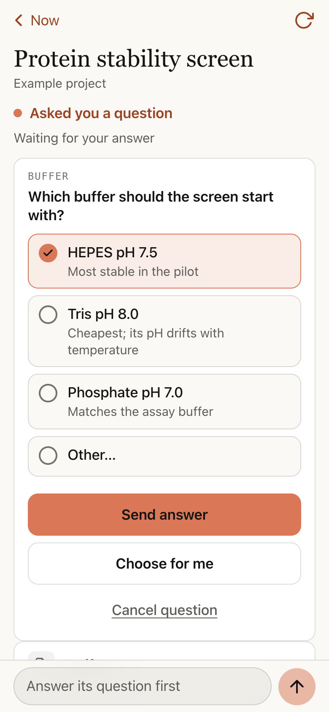
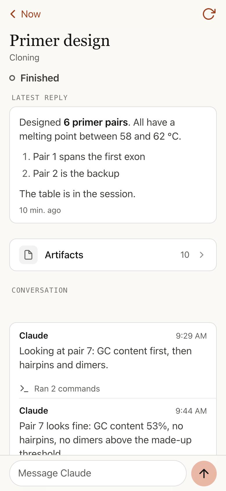
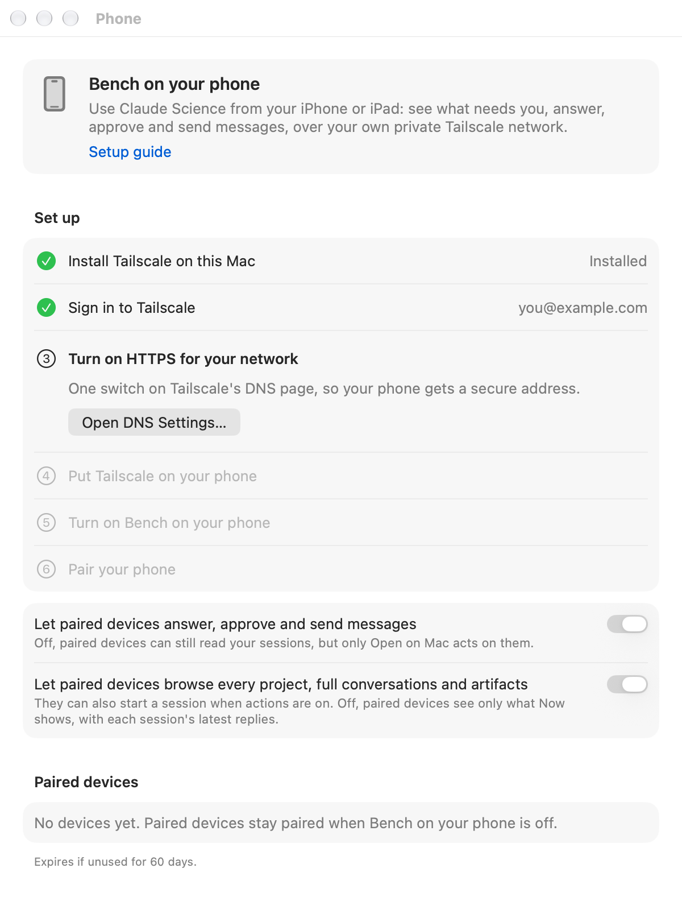
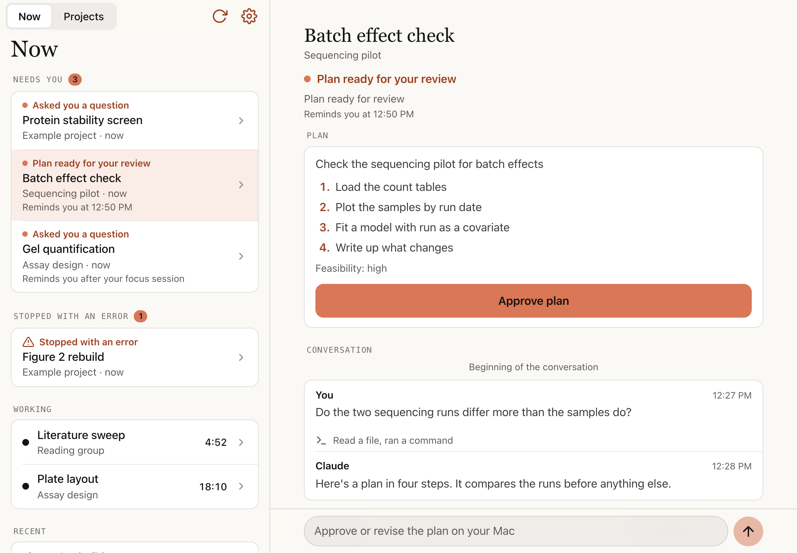

# Bench on your phone

Use Claude Science from your iPhone or iPad when you're away from your Mac.
See what needs you, answer a session's question, approve its plan, send it a
message, scroll back through a conversation and open the files it made. It's
a private web app that Bench serves to your own devices over your own
[Tailscale](https://tailscale.com) network, never the public internet.

  
  &nbsp;
  

## What you need

- Bench 0.4.1 or later, on a Mac with Claude Science (macOS 27, Apple
  silicon).
- [Tailscale](https://tailscale.com/download) on that Mac and on your iPhone or
  iPad, signed in to the **same account**. It's free for personal use.
- For notifications: iOS or iPadOS 16.4 or later.

## Set it up (about five minutes)

Open **Bench → Settings → Phone**. It walks you through six steps and ticks
each one off by itself as you go, so you always know what's left.

  

1. **Install Tailscale on this Mac.** Get it from
   [tailscale.com/download/mac](https://tailscale.com/download/mac).
2. **Sign in to Tailscale.** Remember which sign-in you used (Google, Apple,
   GitHub, Microsoft…): your phone must use the same one.
3. **Turn on HTTPS for your network.** On Tailscale's
   [DNS page](https://login.tailscale.com/admin/dns), under **HTTPS
   Certificates**, click **Enable**. This gives your Mac a proper secure
   address, so your phone treats Bench like a real app.
4. **Put Tailscale on your phone.** Install it from the
   [App Store](https://apps.apple.com/app/tailscale/id1470499037), sign in
   with the same account and switch it on. Bench ticks this step when it sees
   your phone on your network.
5. **Turn on Bench on your phone.** Flip the switch. Bench shows the private
   address it's serving at.
6. **Pair your phone.**
   - Point your iPhone's camera at the QR code in Settings and open the link.
   - In Safari, tap **Share → Add to Home Screen**.
   - Open **Bench from your Home Screen** (not from Safari: they keep separate
     sign-ins) and type the 6-digit code shown in Settings.

That's it. To add an iPad or another phone, press **Pair Another Device**.

## Using it

**Now** lists what needs you, what stopped with an error, what's working
(with live clocks) and what finished lately, plus how much of your plan is
left.

**A session** shows its latest reply and the whole conversation; scroll up
for earlier messages. Tool steps show as one quiet line each ("Ran a command,
read a file"), and files the session made appear under the message that made
them.

- **Answer its question:** tap an option (or several, if it allows), or type
  your own with **Other…**, then **Send answer**. **Choose for me** lets
  Claude decide.
- **Approve its plan:** read the steps and tap **Approve plan**.
- **Send a message:** type at the bottom. If Claude is busy, your message
  waits for its next pause; if the session finished or stopped, it carries
  on from there.

Before any of these, Bench checks the session hasn't changed on your Mac in
the meantime. If it has, you see the latest version instead.

**Projects** lists every project and all its sessions, with search. **New
session** starts one from your phone; turn on **Plan first** to have Claude
propose a plan before doing anything.

**Artifacts** opens a session's files: images, documents, text and tables
show right on the phone; anything else downloads (up to 8 MB). Web pages,
SVGs and notebooks always download rather than open, because they can carry
code.

On an **iPad**, your list and the session sit side by side.

  

### Permission requests

*Needs Bench 0.5.0 or later.*

When a session stops to ask permission, its page shows a **Permission**
card: what it wants and, for code, the code itself in a box you can scroll
(tap **Show all** to see every line). Tap **Allow once** and confirm, and it
runs this one time. **Deny** says no. A request from one of Claude's helper
agents says so at the top.

Only running code and read-only tools can be allowed from the phone, because
those are the only requests where "once" really is once: anything else (a
website, a file, a login) could give lasting access. For those you can Deny
from the phone, or **Open on Mac** and decide there.

Before it answers, Bench checks that it's still the same request waiting. If
it isn't, you see the latest instead.

### Watching it work

*Needs Bench 0.5.0 or later.*

While a session is working and its page is open, a **Writing…** card above the
conversation shows what Claude is writing right now, with a line such as
"Executing code" for what it's doing. It updates every second or two and
disappears when the session stops, and the finished reply then appears in the
conversation. It only asks while the page is showing: leave the page or lock
your phone and it stops.

You see the current passage, not the whole reply: when Claude starts its next
step the card starts over. Only the text it writes shows, never its thinking or
tool output.

### Sending a photo

*Needs Bench 0.5.0 or later.*

Tap the camera button beside the message box (or in **New session**) to
take a photo or pick one from your library. A small preview appears above the
box; tap ✕ to remove it. Add words if you like, then send. Your phone
shrinks the photo to 3,072 pixels on its long side before it leaves, and
Bench saves it again as a plain JPEG, which drops the location and camera
details.

Photos are saved to the project's uploads, where its other sessions can see
them, so send only what you're happy for them to see. If a photo is too big,
isn't a picture, or your words contain a file link, you get a short sentence
saying so, and the photo stays put so you can try again.

### Notifications

In the phone app, tap the gear, then **Turn On Notifications** (this only
works in the app opened from your Home Screen). Choose when you hear from
Bench: when a session needs you, stops with an error, or finishes.

- **Only when I'm away from my Mac** is on by default, so you aren't told
  twice. **Send a Test** always comes through.
- **Show session names** is off by default: a notification just says "A
  session needs you".
- The Bench icon on your Home Screen shows how many sessions need you or
  stopped with an error. Turn this off in the app's Settings.
- Notifications travel through Apple's push service, encrypted so only your
  device can read them. They arrive even when Tailscale is off; opening the
  session needs it on.

## Privacy and security

- **Nothing is on the public internet.** Bench listens only on your Mac, and
  Tailscale passes on requests from your own signed-in devices.
- **Only paired devices get in.** Each has its own sign-in, which you can
  remove in Settings → Phone. A device unused for 60 days is dropped.
- **Your phone sees only text and files.** Replies and messages arrive as
  text: no tool output or file paths. The one exception is a permission
  request, which shows the code it wants to run (up to 4 KB) so you can read
  it before you say yes. A device can only open files Bench has just listed
  to it.
- **Two switches** in Settings → Phone: one for answering, approving,
  allowing code to run and sending messages and photos, one for browsing
  projects, full conversations and files.
- **When Bench quits,** it takes down its Tailscale address, so nothing else
  on your Mac can answer in its place.
- Bench stores paired devices as one-way hashes, in a file only your account
  can read.

## If something's not working

| What you see | What to do |
|---|---|
| Step 4 never ticks | Your phone is signed in to a different Tailscale account. Apple, Google and GitHub sign-ins are separate accounts, even with the same email. Sign out on the phone and sign in the way you did on the Mac. |
| The page won't load at all | Make sure Tailscale is switched on on your phone. The very first visit can take up to a minute while your Mac gets its certificate. |
| "Bench isn't running on your Mac" | Bench is quit, or your Mac is asleep or off the network. Open Bench (and wake the Mac). |
| It keeps asking for a code | Open Bench from your Home Screen, not from Safari: iOS keeps their sign-ins separate. A device unused for 60 days needs pairing again. |
| "Too many wrong codes" | Press **New Code** in Settings → Phone and try again. |
| Send a Test works, real notifications don't | **Only when I'm away from my Mac** is on, and you were at your Mac. |
| A note about other Tailscale Serve sites | Something else on this Mac is also served over Tailscale. It shares Bench's address, so only keep things you trust there. |
| On a university or work network | Tailscale works on most networks, falling back to a relay when needed. A Mac managed by your organisation may not allow Tailscale. |

## Turning it off

Turn off **Use Bench from your phone** in Settings → Phone. Bench stops
serving and removes only its own Tailscale address; your paired devices stay
paired, ready for next time. **Remove All Devices** signs every device out.
